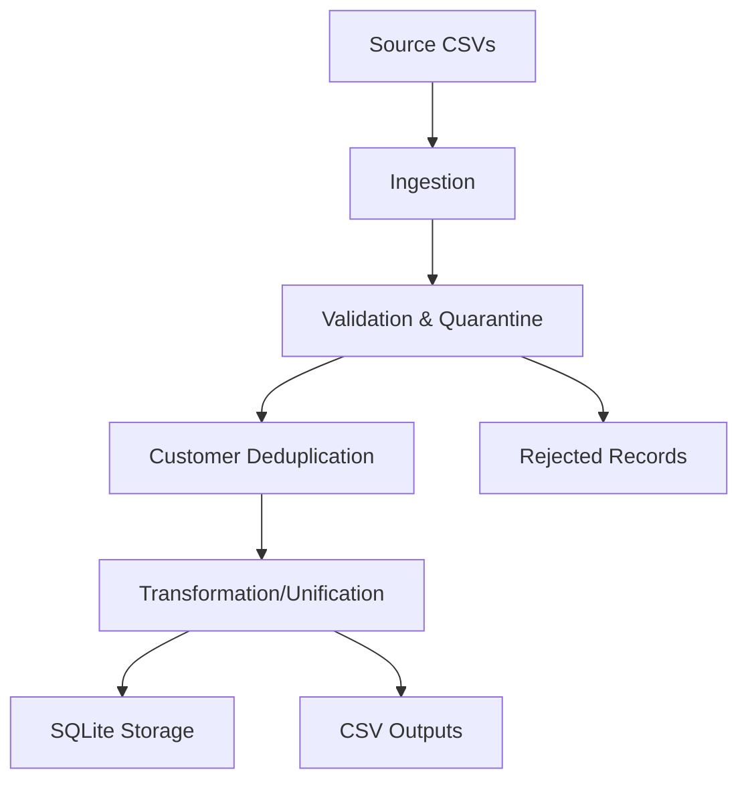

# YottaFlex Customer 360 Data Pipeline

## Overview
A working Data Engineering Pipeline that combines Customers, Accounts, Orders, and Interactions into a unified customer view with deduplication, validation, and reconciliation.

## Features
- Multi-source CSV ingestion
- Data validation and quarantine of invalid records
- Deterministic customer deduplication using normalized email/phone
- Unified customer view with aggregations
- SQLite persistence
- Idempotent reruns
- Pipeline monitoring and run history
- Automated tests
- Reproducible synthetic data generation

## Architecture


## Quick Start
```bash
pip install -r requirements.txt
python generate_sample_data.py
python run_pipeline.py --data-dir data/sample_small --output-dir outputs
```

## Testing
```bash
python -m pytest tests/test_pipeline.py -v
```

## Directory Structure
- `src/` - Source code modules
- `data/` - Input datasets (sample_small, sample_large)
- `outputs/` - Pipeline outputs and database
- `tests/` - Automated tests
- `docs/` - Documentation
- `prompt_history/` - AI prompt history

## Matching Rules (Deterministic)
1. Normalize emails (lowercase, trim)
2. Normalize phones (digits only)
3. Match on normalized email first (strong signal)
4. Match on normalized phone as secondary signal
5. Do not merge on name similarity alone
6. Uncertain/ambiguous matches flagged separately

## Author
YottaFlex AI Candidate Project
